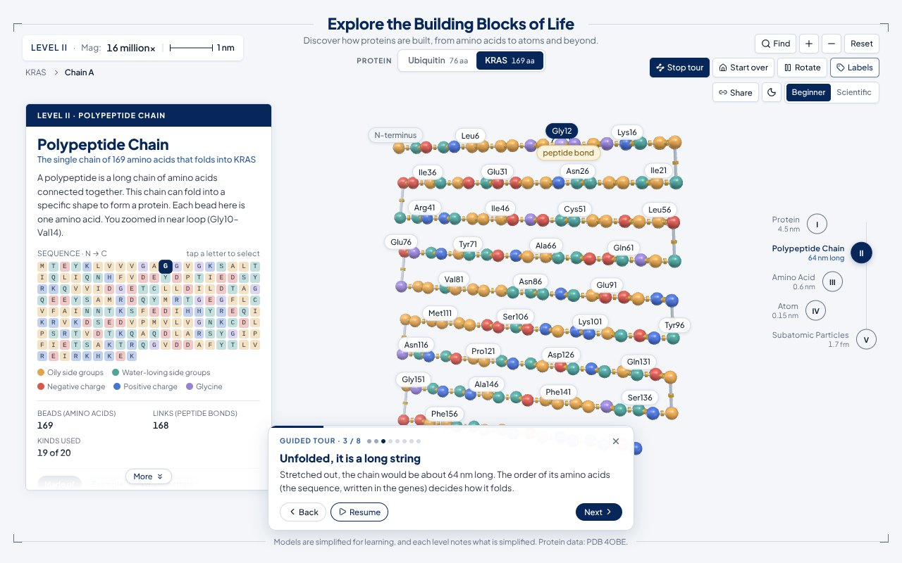
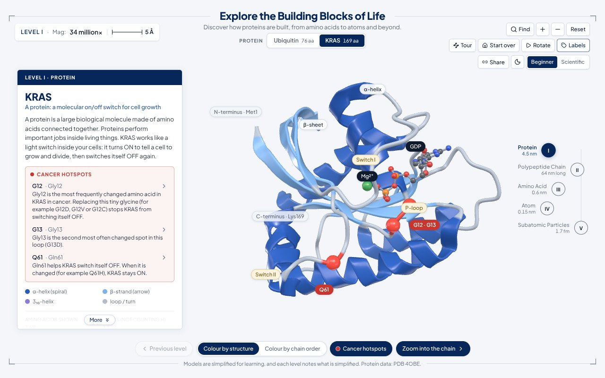
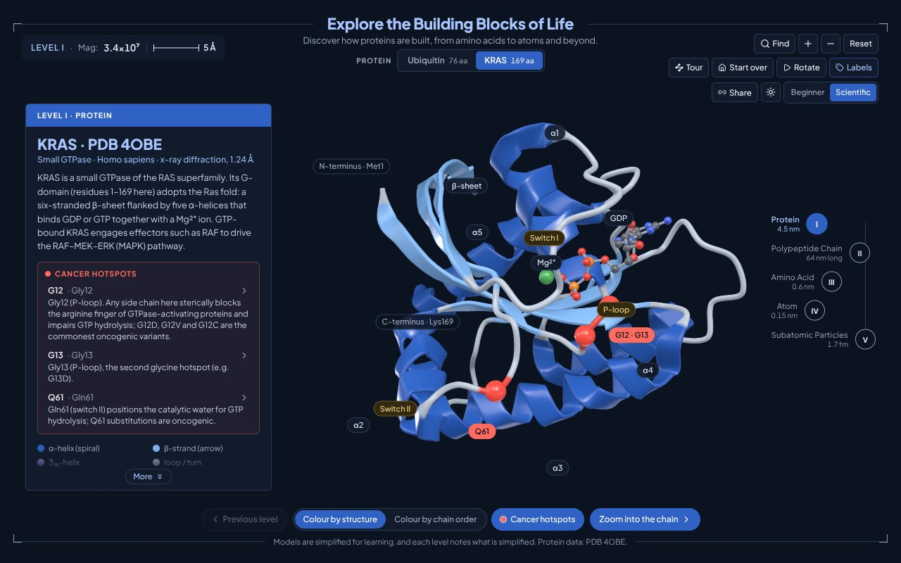
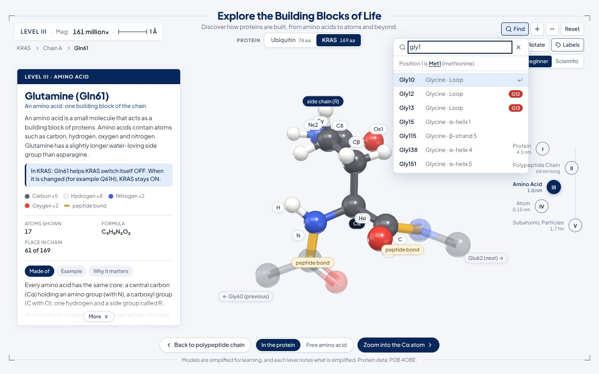
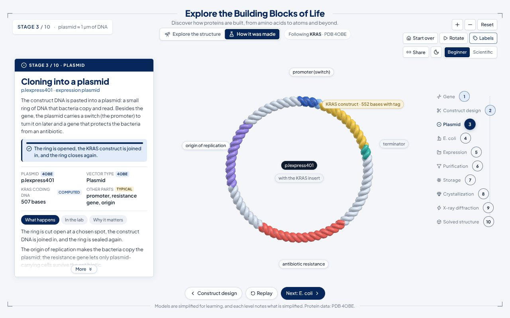
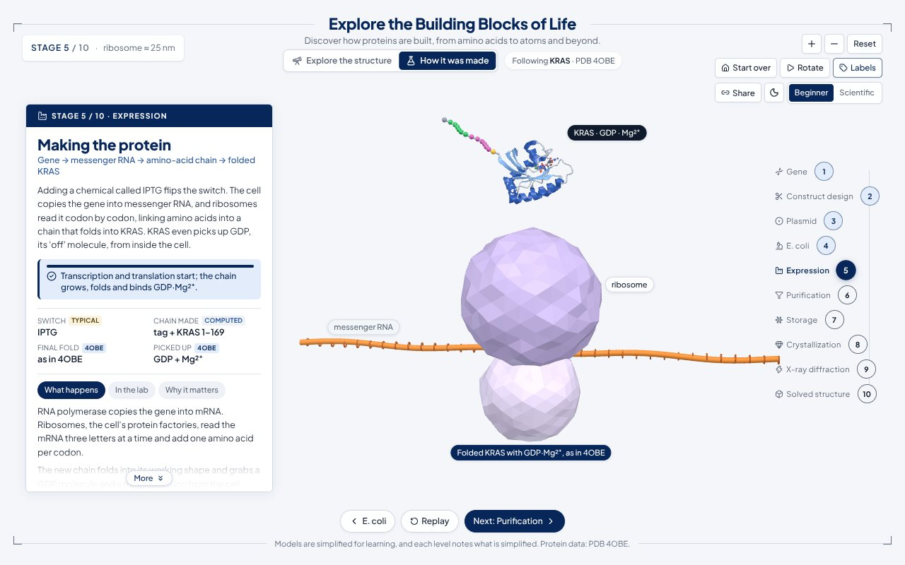
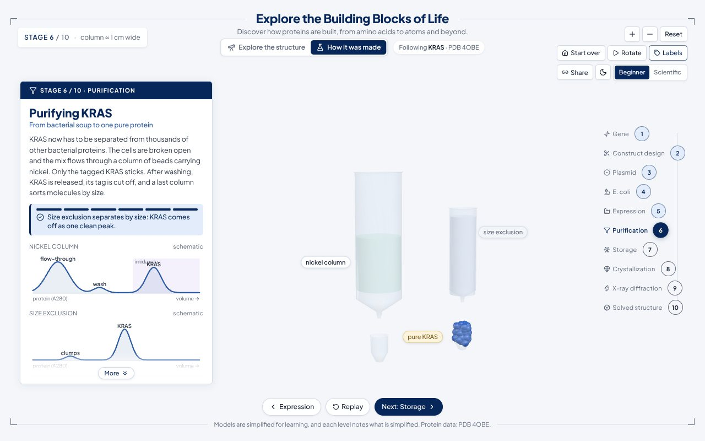
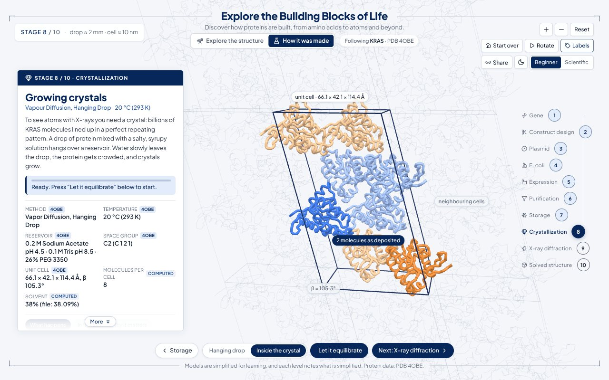
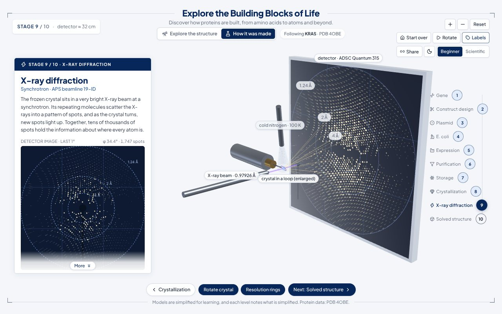
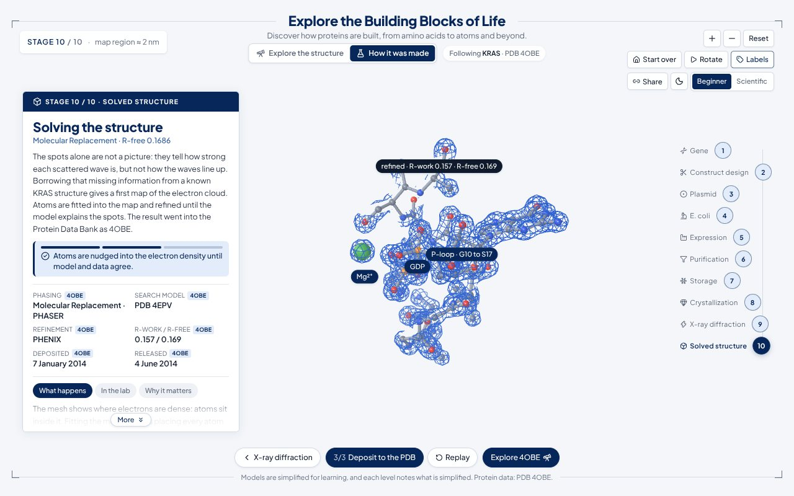

# Explore the Building Blocks of Life

An interactive 3D journey into a real protein. Start with the folded protein **ubiquitin** (PDB 1UBI) or the cancer protein **KRAS** (PDB 4OBE) and zoom continuously through five levels of structure:

**Protein → Polypeptide Chain → Amino Acid → Atom → Subatomic Particles**

A second section, **How it was made**, follows the same KRAS molecule through the lab in ten interactive 3D stages, from its gene to the deposited structure, using what the 4OBE file records about its own experiment.

Click any part to fly into it. The camera approaches the component you picked, the surrounding structure swells past the camera and dissolves, and the next level grows out of the exact spot you clicked. Every level is real, interactive 3D (Three.js / React Three Fiber), built from measured coordinates wherever they exist. Each level states clearly what has been simplified. New visitors can press **Tour** and watch the whole journey with captions.


| II · Polypeptide chain | III · Amino acid (Gly10) | IV · Carbon-12 atom | V · Subatomic particles |
| --- | --- | --- | --- |
|  |  |  |  |
|  |  |  |  |

### Features at a glance

* **Guided tour**: one click zooms through all five levels on its own, with a caption at each stop (pause, step back or skip at any time).
* **Real sizes**: the level navigation shows how big each level really is, measured from the structure: protein 4.5 nm, stretched chain 64 nm, amino acid 0.6 nm, atom 0.15 nm, proton 1.7 fm (KRAS).
* **Cancer hotspots** (KRAS): highlights Gly12, Gly13 and Gln61 on the ribbon and the chain, explains what each mutation does and jumps straight to it.
* **Find an amino acid**: type `G12`, `Lys48`, `61` or `glycine` and open it at Level III.
* **Shareable links**: the address bar always describes the current view, and **Share** copies it.
* **Dark mode**: follows the system setting until you choose; remembered per browser.
* **Numbered helices** in Scientific mode (α1 to α5 for KRAS), labels that keep clear of the panels, and a "More" cue when the info card scrolls.

| Guided tour | Cancer hotspots | Dark mode | Find |
| --- | --- | --- | --- |
|  |  |  |  |

---

## Proteins

Use the **Protein** switcher (top centre) to choose a structure. Each one starts on a showcase glycine.

| Protein | PDB entry | Starts at | Notes |
| --- | --- | --- | --- |
| Ubiquitin | 1UBI (X-ray, 1.8 Å), bundled in `public/pdb/1UBI.pdb` | Gly10 | The "recycle me" tag; Lys48 chain-link site labelled |
| KRAS | 4OBE (X-ray, 1.24 Å; KRAS G-domain, residues 1–169, with GDP and Mg²⁺), bundled in `public/pdb/4OBE.cif` | Gly12, the commonest cancer hotspot | P-loop, switch I and switch II labelled; GDP and Mg²⁺ drawn as ball-and-stick |


For KRAS, the **Cancer hotspots** toggle (Levels I and II) marks the three classic oncogenic positions, G12, G13 and Q61, in red; the info card lists what each change does, with a shortcut into each one.

Structures can be in either the classic PDB format (`.pdb`) or PDBx/mmCIF (`.cif`, the wwPDB's current standard format); the app detects the format from the file contents. It loads the bundled copy first and, if that file is missing, downloads it from `files.rcsb.org` in the browser. To add another protein, drop its structure file into `public/pdb/` and add an entry to `src/content/proteins.ts` (file, chain, start residue, functional sites, residue notes and Level I text).

## How it was made: from gene to structure

Switch to **How it was made** (top centre) to follow KRAS (PDB 4OBE) through the ten steps that produced the structure. Each stage is its own 3D scene with lab steps you trigger (**Add IPTG**, **Load the nickel column**, **Let it equilibrate**, …), a card that explains it at Beginner or Scientific level, and a note on what is simplified. Arrow keys move between stages; the last stage opens the finished structure in the explorer.

| # | Stage | What you see |
| --- | --- | --- |
| 1 | Gene | KRAS on chromosome 12 (12p12.1), then a to-scale B-DNA close-up of codons 10 to 21 with codons 12 (GGT) and 13 (GGC) spelled out |
| 2 | Construct design | The 188 residues trimmed to the G-domain (1 to 169) and a His-tag plus TEV site added; Gly0, which 4OBE flags as an expression tag, stays behind |
| 3 | Plasmid | The construct pasted into a pJExpress401 ring with promoter, origin and resistance gene |
| 4 | E. coli | BL21(DE3) cells take up the plasmid; the antibiotic clears the cells without it; the colony grows |
| 5 | Expression | IPTG switches the gene on; a ribosome reads the mRNA and the chain folds into the real 4OBE fold and picks up GDP·Mg²⁺ |
| 6 | Purification | Cells broken open, nickel column (flow-through, wash, imidazole), tag cut off, size exclusion, with schematic chromatograms |
| 7 | Storage | Concentrated, split into single-use tubes, flash-frozen in liquid nitrogen, kept at −80 °C |
| 8 | Crystallization | A hanging drop shrinks and crystals grow; inside the crystal, the real C2 unit cell holds 8 KRAS molecules made from the 2 deposited ones by symmetry |
| 9 | X-ray diffraction | The crystal turns in the beam at APS 19-ID; spots calculated from the 4OBE atoms light up on an ADSC Quantum 315 detector, with a flat detector image you can hover |
| 10 | Solved structure | Molecular replacement places a search model, refinement settles the atoms into calculated electron density, and the model is deposited as 4OBE |

| Plasmid | Expression | Purification |
| --- | --- | --- |
|  |  |  |
| **Inside the crystal** | **X-ray diffraction** | **Refined in the electron density** |
|  |  |  |

Every fact on a stage card carries a badge saying where it comes from: **4OBE** (read from the file: gene names, expression host and plasmid, crystallization recipe, cell and space group, beamline, wavelength, detector, dates, R-factors), **computed** (worked out from the file, such as the molecules per cell and the solvent content), or **typical** (common lab practice that the file does not record, such as storage temperatures).

---

## Quick start

Requirements: **Node.js ≥ 20.9** and npm.

```bash
npm install
npm run dev          # http://localhost:3000
```

Production build:

```bash
npm run build
npm start            # http://localhost:3000
```

Other scripts: `npm run lint`, `npm run typecheck`.

No API keys or network access are needed at runtime. Both protein structures ship with the app (`public/pdb/`), and fonts and lighting are bundled locally.

---

## What you can do

| Level | What you see | Interact |
| --- | --- | --- |
| **I · Protein** | Ubiquitin as a cartoon ribbon computed from the crystal structure: α-helix, 3₁₀-helix, five β-strands (arrows), loops. Zoom close and the side-chain bonds fade in. | Hover a helix, strand or loop to highlight it. Click to zoom into the chain at that spot. Colour by structure or by chain order (N→C rainbow). |
| **II · Polypeptide chain** | One bead per amino acid at its real Cα position, coloured by side-chain type. Gold bands sit at the real C–N peptide-bond positions, with a faint outline of the folded ribbon behind. | Hover or click beads, or tap letters in the sequence strip. **Unfold chain** straightens all 76 residues into a serpentine N→C line, then folds them back. |
| **III · Amino acid** | Ball-and-stick model of the selected residue (Gly10 by default) from the crystal structure, with hydrogens added. Neighbouring residues are ghosted and both peptide bonds highlighted. | Hover any atom for its name, element and bonds. Click an atom to zoom into it. Toggle **In the protein ↔ Free amino acid**; the atoms released as water when a peptide bond forms get a blue halo. |
| **IV · Atom** | The atom you clicked: carbon-12 (6 p⁺, 6 n⁰, 6 e⁻), or H, N, O, S with their correct counts. Stubs point along its real bonds back in the amino acid. | Click a proton, neutron or electron. Toggle **Orbit model (simplified) ↔ Electron cloud** (orbital probability densities). |
| **V · Subatomic particles** | Proton (uud), neutron (udd) and electron side by side, with quarks, gluon "springs", electric-field arrows (out of +, into −) and brackets showing which particles live in the nucleus. | Select a particle to compare charge and mass. Toggle quarks and the charge field. |

**Learning modes:** *Beginner* uses short, everyday explanations. *Scientific* adds terminology, formulas, φ/ψ torsion angles and bond lengths measured from the coordinates, isotope data and particle constants. The info card has *Made of / Example / Why it matters* tabs, shows how each level relates to the levels above and below, and ends with a note on what is simplified.

### Controls

| Action | Mouse / touch | Keyboard |
| --- | --- | --- |
| Rotate | drag | Space toggles auto-rotate |
| Zoom | wheel / pinch, or the `+` `−` buttons | `+` / `−` |
| Pan | right-drag / two-finger drag | |
| Zoom into a component | click it | `→` (zooms into the current selection) |
| Previous level | "Back to …" button | `←` or `Esc` |
| Jump to any level | right-hand I–V navigation or the breadcrumb | |
| Find an amino acid | **Find** | `/` |
| Guided tour | **Tour** (or "Take the tour" in the first hint) | `T`; during the tour `←` `→` step and `Esc` ends it |
| Reset view / start over | **Reset** / **Start over** | `R` |
| Labels | **Labels** | `L` |
| Beginner ↔ Scientific | toggle | `M` |
| Light ↔ dark theme | moon / sun button | `D` |
| Copy a link to this view | **Share** | |

The magnification and scale bar in the top-left pill update live as you zoom (Levels I–III use real Å/nm scale; IV–V are marked schematic). The level navigation on the right gives the real size of each level.

### Shareable links

The address bar mirrors the view, so any view can be bookmarked or sent:

| Parameter | Meaning | Example |
| --- | --- | --- |
| `p` | protein: `ubiquitin` or `kras` | `p=kras` |
| `l` | level 1 to 5 | `l=3` |
| `r` | residue number | `r=12` |
| `a` | atom name in that residue | `a=CA` |
| `x` | particle at Level V: `proton`, `neutron`, `electron` | `x=electron` |
| `m` | `sci` for Scientific mode | `m=sci` |
| `v` | view option: `unfolded` (II), `free` (III), `cloud` (IV) | `v=cloud` |
| `h` | `1` to show cancer hotspots (I and II) | `h=1` |
| `view` | `make` opens How it was made | `view=make` |
| `s` | stage 1 to 10 in How it was made | `s=9` |

For example, `/?p=kras&l=4&r=12&a=CA` opens the α-carbon of KRAS Gly12. `/?view=make&s=9` opens the X-ray diffraction stage.

---

## Scientific notes and simplifications

* **Data.** PDB entry **1UBI**: human ubiquitin, X-ray diffraction at 1.8 Å (Ramage *et al.*, *Biochem. J.* 299:151, 1994). PDB entry **4OBE**: GDP-bound human KRAS, chain A, X-ray diffraction at 1.24 Å (Hunter *et al.*, *PNAS* 111:8895, 2014); its expression-tag Gly0 is unobserved, so the model runs Met1–Lys169. PDB data is CC0 / public domain. Secondary structure comes from the entry's own HELIX/SHEET records. The structure is centred and rotated onto its principal axes using a proper rotation (det = +1), so the chirality of the L-amino acids is preserved.
* **Ribbon.** A centripetal Catmull–Rom spline runs through the Cα atoms. Ribbon orientation follows the C=O vectors, so helices coil and β-sheets lie flat. Arrows point N→C.
* **Bead model (II).** One bead stands for a whole residue. This simplification is stated on screen.
* **Amino acid (III).** Heavy atoms are the crystal coordinates. X-ray structures rarely resolve hydrogens, so they are placed from residue templates (4OBE includes riding hydrogens added during refinement; these are skipped so both proteins are drawn the same way) with ideal geometry (C–H 1.09 Å, N–H 1.01 Å, O–H 0.96 Å; sp³ tetrahedral, sp² trigonal). Protonation states are for pH ≈ 7: Lys/Arg protonated, Asp/Glu deprotonated, His as the Nε2–H tautomer, a charged N-terminus and C-terminus. The free amino acid uses the neutral textbook form; the scientific text notes the zwitterion. Formulas are counted from the displayed atoms and verified against reference formulas for every residue type in ubiquitin.
* **Atom (IV).** The Bohr-style orbits carry an on-screen warning that electrons do not travel in fixed planetary orbits. The cloud view samples Slater-type 1s/2s/2p densities (Clementi–Raimondi exponents; radial nodes omitted) and fills p orbitals by Hund's rule. The nucleus is enlarged about 10⁴×; the text states the real scale ("a 1 cm marble → an atom about 280 m across").
* **How it was made: crystal (8).** The unit cell, space group (C 1 2 1) and symmetry operators come from the file. Each of the 8 molecules in the cell is a symmetry copy of one of the two deposited chains, moved by whole cells so its centre lies inside the box; the hover gives the operator, e.g. −x+1/2, y+1/2, −z. The Matthews coefficient computed from the cell (1.99 ų/Da, 38% solvent) matches the file. The hanging drop is schematic and days are compressed into seconds.
* **How it was made: diffraction (9).** Spots are calculated in the browser: every reflection to the file's 1.24 Å limit is enumerated from the cell, systematic absences are removed (for C2, h + k odd), and each reciprocal-lattice point is recorded where it crosses the Ewald sphere at the recorded wavelength (0.97926 Å) as the crystal turns. Intensities are |F|², summed over all 2,738 heavy atoms and the symmetry operators with four-Gaussian form factors and each atom's B-factor; they agree with a direct brute-force sum to within a few percent. Lorentz and polarisation factors, background, noise and spot shape are left out. The detector distance (about 150 mm) is chosen so the 1.24 Å limit reaches the detector edge, and the crystal mounting is arbitrary. The crystal, loop and pin are enlarged.
* **How it was made: solved structure (10).** The mesh is electron density calculated from the deposited atoms of the P-loop, GDP and Mg²⁺ (each atom's form factor and B-factor, contoured at 1.2 e/ų); the first map adds 50 Ų to every B to look blurry. The search model is drawn with 4OBE's own atoms, since 4EPV is not bundled, and the refinement is schematic. R-work and R-free are the file's values.
* **Particles (V).** Charges, masses, quark content and lifetimes are standard values. Sizes and colours are schematic, and the gluon springs are only a suggestion of the strong force.

---

## Project structure

```
public/pdb/                      Real coordinates loaded at runtime: 1UBI.pdb, 4OBE.cif
src/
  app/                           Next.js App Router: layout, page, global styles, icon
  components/
    ExplorerShell.tsx            Static frame + client-only dynamic import of the explorer
    Explorer.tsx                 Overlay layout (desktop side panel / mobile bottom sheet)
    useKeyboardShortcuts.ts
    ui/                          FrameChrome, ScalePill, Breadcrumb, ViewControls, LevelNav,
                                 InfoPanel + LevelWidgets, BottomBar, HoverTooltip, Hints,
                                 LabelOverlay, LoadingState, ProteinSwitcher, ResidueSearch, Tour
  pipeline/                      How it was made: ten lab stages in their own canvas
    PipelineView.tsx             Layout: stage pill, section tabs, stage card, actions, navigation
    PipelineCanvas.tsx           Canvas, lights, mounts the current (or outgoing + incoming) stage
    PipelineCamera.tsx           Per-stage framing, fly-through between stages, re-framing on steps
    PipelineStage.tsx            Scale and fade of a stage during a change
    runtime.ts                   Per-frame transition state and the debug speed
    stages/                      GeneStage, ConstructStage, PlasmidStage, CellStage, ExpressionStage,
                                 PurificationStage, StorageStage, CrystalStage, DiffractionStage,
                                 StructureStage (+ index.tsx registry)
    lib/crystalPacking.ts        Unit-cell packing, cell edges, symmetry operator text, crystal shape
    lib/diffraction.ts           Reflections, absences, Ewald crossings and |F|² (built in slices)
    lib/density.ts               Calculated electron density and its chicken-wire contour
    lib/viewFade.ts              Cross-fade between two views of a stage
    ui/                          StagePanel, StageWidget (keys, chromatograms, thermometer,
                                 detector image), StageControls, PipelineNav, StagePill
  content/                       Educational content (separate from rendering)
    proteins.ts                  The proteins on offer: file, start residue, sites, Level I text
    info.ts                      Beginner/scientific text per level, hover text, breadcrumb
    aminoAcids.ts                Reference data for all 20 amino acids
    levels.ts                    Level names, numerals, real-world scale, real size per level
    tour.ts                      Guided tour steps and captions
    pipeline.ts                  Stage names and text, facts with their sources, lab steps
  lib/                           Pure scientific/geometry code (no React)
    pdb/parsePdb.ts              Fixed-column PDB parser (ATOM, HETATM, HELIX, SHEET)
    pdb/parseCif.ts              PDBx/mmCIF reader (atom_site, struct_conf, struct_sheet_range)
    pdb/experiment.ts            How the entry was made (gene, host, crystal, beamline, refinement)
                                 plus the unit cell, symmetry operators and asymmetric-unit atoms
    structure/protein.ts         Protein model: centring, principal axes, regions, loading
    structure/chainLayout.ts     Folded / unfolded bead layouts
    geometry/ribbon.ts           Cartoon ribbon mesh builder (+ per-residue picking)
    chem/elements.ts             H, C, N, O, S: CPK colours, isotopes, shells, orbitals
    chem/residueTemplates.ts     Bonds, bond orders, hydrogen specs for 20 residues
    chem/geometry.ts             Ideal hydrogen placement, ideal Cβ
    chem/residueMolecule.ts      Level III model (residue + free forms, neighbours, formulas)
    atom/atomModel.ts            Nucleon packing, Bohr shells, orbital cloud sampling
  scene/                         3D rendering (React Three Fiber)
    SceneCanvas.tsx              Canvas, lights, adaptive DPR, fog
    SceneThemeSync.tsx           Background, fog and colour mixing follow the light / dark theme
    StageManager.tsx             Mounts current / outgoing / incoming level stages
    StageGroup.tsx               Per-stage transform + material fade during transitions
    TransitionController.tsx     Staged zoom: approach → dissolve → settle (both directions)
    CameraRig.tsx                CameraControls, panel-aware view offset, zoom/reset, scale bar
    framing.ts                   Per-level camera framing and zoom anchors
    runtime.ts                   Mutable per-frame state shared outside React
    levels/                      ProteinLevel, PolypeptideLevel, AminoAcidLevel, AtomLevel,
                                 ParticleLevel, atomLayout
    shared/                      Palette, SceneLabel + label registry, geometry helpers
  store/
    explorerStore.ts             Zustand: level, selection path, modes, toggles, theme, transitions
    dataStore.ts                 Loaded proteins + memoised per-residue molecules
    tourStore.ts                 Guided tour state (step, pause, progress)
    pipelineStore.ts             How it was made: stage, steps per stage, view toggles, transitions
    urlState.ts                  Shareable links: read the address on load, keep it in sync
```

### How a transition works

1. A click calls `drillDown(selection, clickedPoint)` in the store, which records a `TransitionRequest` (from, to, anchor).
2. `StageManager` mounts the incoming level alongside the outgoing one.
3. `TransitionController` runs every frame, outside React:
   * **approach**: the camera eases toward the anchor while the rest of the outgoing level dims;
   * **dissolve**: the outgoing level scales up around the anchor and fades, the incoming level grows from the anchor, and a soft backdrop blur peaks;
   * **settle**: the camera frames the new level.
4. Zooming out runs in reverse: the child shrinks back into its place and the parent condenses from a close-up. When you go back up, the camera restores the view you last had at that level.
5. Protein ↔ chain share coordinates, so that step is an in-place morph: the ribbon fades as beads ripple outward from where you clicked.

---

## Tech stack

Next.js 16 (App Router, Turbopack) · React 19 · TypeScript · Three.js · @react-three/fiber · @react-three/drei · Tailwind CSS v4 · Motion · Zustand · lucide-react · Fontsource (Plus Jakarta Sans).

**Visual style:** a navy-on-white identity (primary `#07265A`) with grey-blue panels, navy section bars and a single geometric sans (Plus Jakarta Sans) for headings and text. All colours are Tailwind theme tokens in `src/app/globals.css` (`brand`, `brand-ink`, `brand-mid`, `brand-soft`, `surface`, `paper`, `panel`, `ink`, `body`, `muted`, `faint`, `line`, `hotspot`); the dark theme redefines the same tokens under `[data-theme="dark"]`, so components need no theme logic. Every text colour meets WCAG AA contrast (4.5:1) in both themes. A small script in the page head applies the saved or system theme before first paint. The 3D scene palette lives in `src/scene/shared/palette.ts`, and its background matches `--color-paper` so the depth fog blends in.

* `three` is pinned to **0.182.0**. React Three Fiber 9.x still creates a `THREE.Clock`, which three r183+ deprecates with a console warning; 0.182 keeps the console clean.
* 3D labels use a small custom overlay (`LabelOverlay`) instead of drei's `<Html>`. Each `<Html>` creates its own React root, and unmounting many of them in one commit (which every level transition does) can race in React 19.
* WebGL resources created imperatively are disposed on unmount. Rendering adapts its pixel ratio to device performance.

### Debugging

Append `?debug` to the URL to expose `window.__explorer`, which holds the stores, scene refs and a `transitionRuntime.timeScale` you can lower to watch transitions frame by frame. In How it was made, `pipelineRuntime.speed` speeds up or slows down the stages' own animations.
